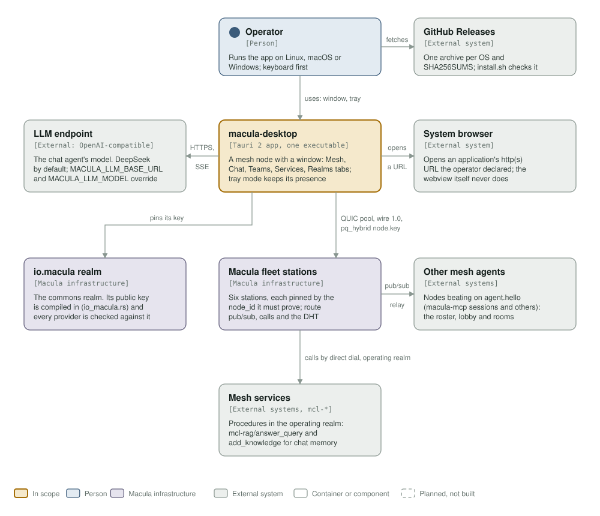
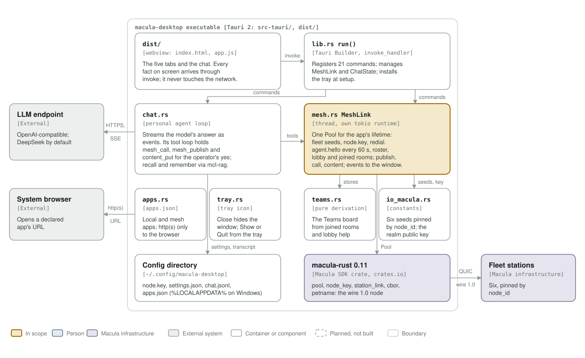

# macula-desktop architecture: C4 model

*This exists so an operator can hold a live presence on the Macula mesh, and talk to it and to an agent, from one desktop executable that opens no port.*

**Status: macula-desktop 0.2.0** (`src-tauri/Cargo.toml`), on `macula-rust` 0.11, wire 1.0. One Tauri 2 executable per OS (Linux, macOS, Windows), released on GitHub Releases.

Legend, the same in both diagrams: amber is the element in scope, blue a person, lavender-grey **Macula infrastructure** (the stations, the realm, the macula SDK), grey-green an external system, white a component, a thin solid rounded outline with a muted label a boundary, and dashed boxes are planned, not built (none here).

## Level 1: system context

| Element | Kind | Role |
| --- | --- | --- |
| macula-desktop | In scope | A Tauri 2 app whose Rust core is a mesh node: the Mesh, Chat, Teams, Services and Realms tabs; tray mode keeps its mesh presence while the window is closed |
| Operator | Person | Runs the app, keyboard first; installs it from GitHub Releases, by hand or with `install.sh` / `install.ps1` |
| GitHub Releases | External system | One archive per OS and `SHA256SUMS`, published by `release.yml` on a `v*` tag; the install scripts check the archive against it |
| LLM endpoint | External system | The chat agent's model, any OpenAI-compatible endpoint (DeepSeek by default; `MACULA_LLM_BASE_URL`, `MACULA_LLM_MODEL`), called from the Rust core over HTTPS, answers streamed as SSE |
| System browser | External system | Opens an application's http(s) URL the operator declared in `apps.json`; nothing else leaves the app this way |
| io.macula realm | Macula infrastructure | The commons realm: its public key is compiled in (`io_macula.rs`), and every provider the pool trusts is checked against it |
| Macula fleet stations | Macula infrastructure | The six fleet stations, each pinned by the node_id it must prove; the pool links to them over QUIC (wire 1.0, a pq_hybrid `node.key`) and they carry pub/sub, calls and the DHT |
| Other mesh agents | External systems | Nodes beating on `agent.hello` (macula-mcp sessions and others): the roster, `agents.lobby` room announcements and help broadcasts, and joined `agents.room.*` rooms |
| Mesh services | External systems | Procedures called by direct dial in the operating realm; the chat's memory is `mcl-rag/answer_query` and `mcl-rag/add_knowledge` |

## Level 3: components of the executable

| Component | Kind | Role |
| --- | --- | --- |
| `dist/` | Webview (`index.html`, `app.js`, `style.css`, `vendor/marked.min.js`) | Renders the five tabs and the chat; every fact arrives through `invoke`, and it never touches the network |
| `lib.rs` `run()` | Tauri Builder | Registers the 21 invoke commands, manages `MeshLink` and `ChatState`, installs the tray, hides the window on close |
| `mesh.rs` `MeshLink` | Thread with its own tokio runtime | One `macula-rust` `Pool` for the app's lifetime: the fleet seeds, the persistent `node.key`, redial; the `agent.hello` heartbeat every 60 s and the roster, the lobby and joined rooms; publish, call, content get/put; events to the webview |
| `chat.rs` | Personal agent loop | Streams the model's answer to the webview as events; its tool loop runs mesh tools through `MeshLink`, and `mesh_call`, `mesh_publish` and `content_put` wait for the operator's approval; recall and remember through mcl-rag; may react to a mesh event |
| `teams.rs` | Pure derivation | The Teams board from joined rooms and lobby help broadcasts |
| `io_macula.rs` | Constants | The six seeds pinned by node_id and io.macula's public realm key |
| `apps.rs` | `apps.json` | Local and mesh applications the operator declares; hands an http(s) URL to the system browser |
| `tray.rs` | Tray icon | Close hides the window; Show or Quit from the tray menu |
| Config directory | Files | `~/.config/macula-desktop` (`%LOCALAPPDATA%` on Windows): `node.key`, `settings.json`, `chat.jsonl` (the transcript), `apps.json` |
| `macula-rust` 0.11 | Macula SDK crate | `pool`, `node_key`, `station_link`, `cbor`, `petname`: the wire 1.0 node the core is built on, the app's only macula-io dependency |

## Editing the diagrams

Both SVGs in [`../assets/`](../assets/) are generated by [`c4_diagrams.py`](c4_diagrams.py): run `python3 architecture/c4_diagrams.py` from the repository root, render each (`rsvg-convert -w 1400 assets/c4-context.svg -o /tmp/c.png`) and look at it. Colours are plain classes with a `prefers-color-scheme: dark` block, never CSS custom properties, which `rsvg-convert` renders black. Keep this file's tables in step with the diagrams; the `c4-model.yml` workflow fails when a diagram goes missing or unlinked.
